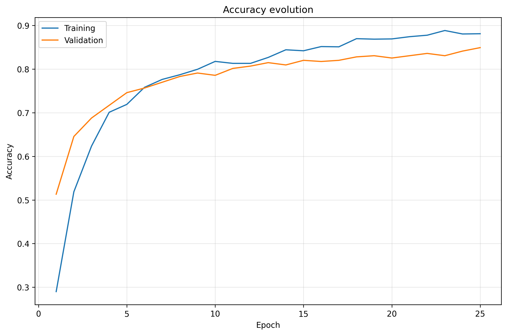
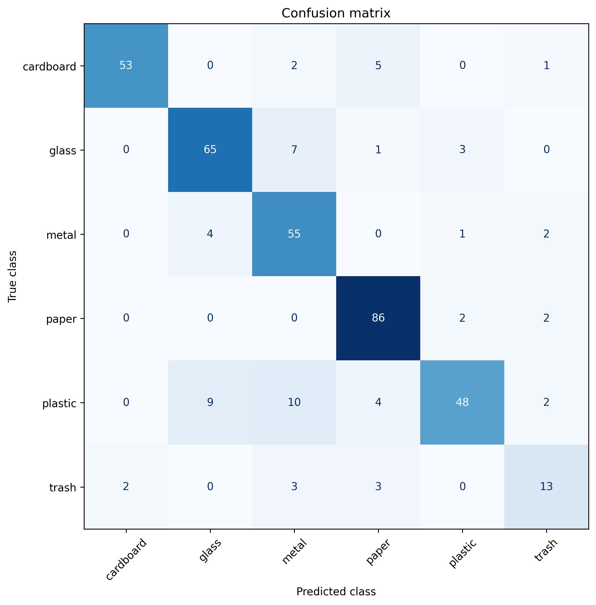
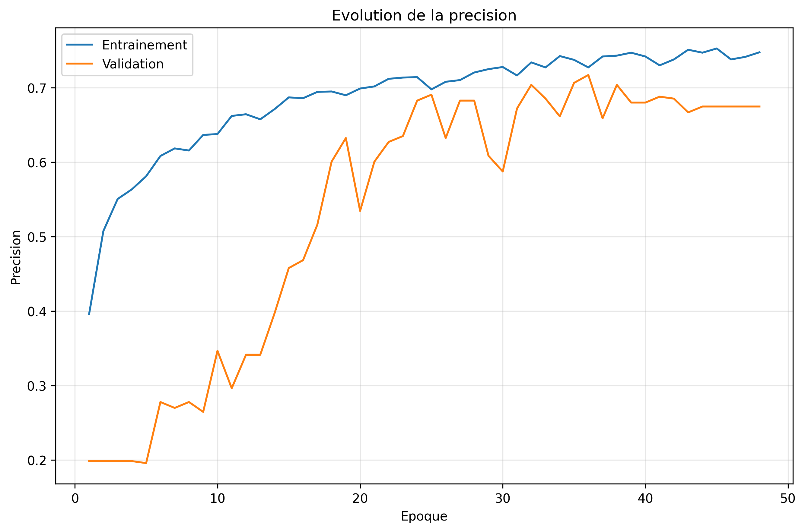
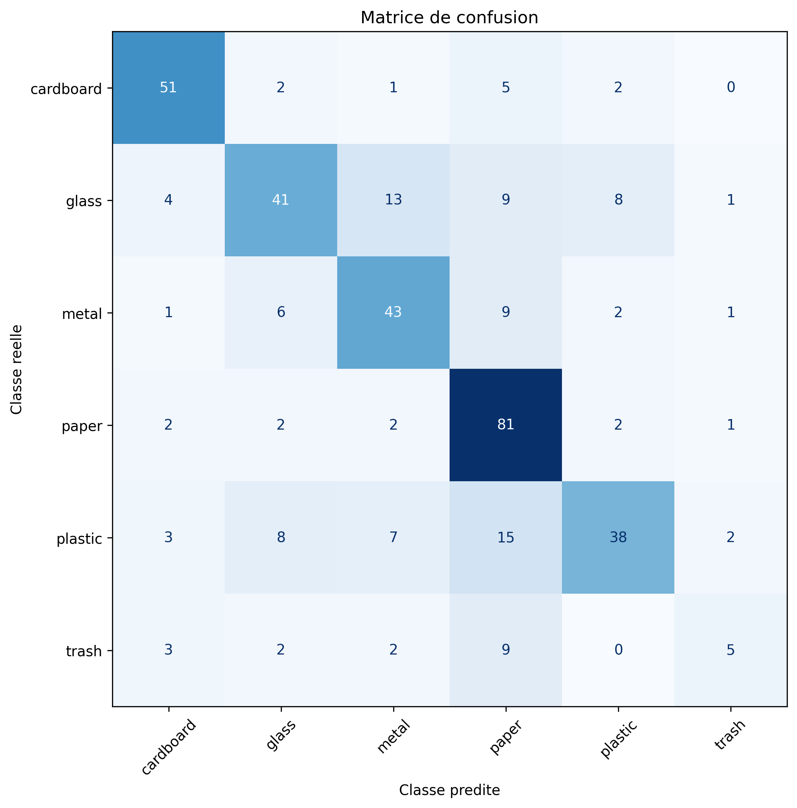

# Waste Classification with CNN and ResNet50

This project implements a modular deep-learning pipeline for classifying waste images into six categories:

- cardboard
- glass
- metal
- paper
- plastic
- trash

The project supports both a custom Convolutional Neural Network (CNN) and a transfer-learning model based on ResNet50.

## Results at a glance

**Best reported model: ResNet50 (ImageNet transfer learning).** This project compares it with a custom CNN for six-class waste classification.

| Model | Best validation accuracy | Test accuracy |
| --- | ---: | ---: |
| **ResNet50** (ImageNet pretrained) | **88%** | **86%** |
| Custom CNN | 72% | 68% |

**ResNet50 outperformed the custom CNN by 18 percentage points in reported test accuracy.** Models were compared using validation accuracy; the held-out test set contains **383 images**. Values above are *rounded results from the final academic project presentation (2026)*, not benchmarks independently re-run from the committed repository.

### Dataset and evaluation protocol

The dataset contains **2,527 labeled images** in six categories: cardboard, glass, metal, paper, plastic, and trash.

| Split | Images | Approximate share |
| --- | ---: | ---: |
| Training | 1,766 | 70% |
| Validation | 378 | 15% |
| **Test** | **383** | **15%** |
| **Total** | **2,527** | **100%** |

The counts are documented in the [executed notebook](notebooks/main_pipeline_project.ipynb). The splitting code uses a fixed random seed (42).

- **Custom CNN:** configurable convolutional network with normalization, pooling and classification layers.
- **ResNet50:** transfer learning from ImageNet pretrained weights with a task-specific classification head.
- **Model selection:** model checkpoints are selected by validation accuracy using the Keras ModelCheckpoint callback.
- **Test evaluation:** test loss/accuracy, per-class precision/recall/F1, classification report and confusion matrix are generated by the evaluation script.

### Visual results

**ResNet50 — best reported model**




[ResNet50 loss curves](results/resnet/loss.png) · [ResNet50 results folder](results/resnet/)

**Custom CNN — baseline comparison**




[CNN loss curves](results/cnn/loss.png) · [CNN results folder](results/cnn/)

> **Reproducibility note:** the public results folder contains selected plots, but detailed experiment metadata, trained model checkpoints, full prediction files and per-run evaluation JSON reports are not currently committed. The rounded scores above were taken from the final presentation and cannot yet be independently reproduced from public model artifacts alone. No final-model F1 score is claimed here without its matching evaluation report.


## Project objectives

The main objectives are to:

- download and organize the Garbage Classification dataset;
- split the images into training, validation, and test sets;
- preprocess the images with TensorFlow;
- train and compare CNN and ResNet50 models;
- evaluate the models using accuracy, loss, a classification report, and a confusion matrix;
- save every experiment and automatically track the best model in each model family;
- predict the class of individual test images.

## Project structure

```text
waste-classification/
├── README.md
├── requirements.txt
├── .gitignore
├── LICENSE
├── src/
│   ├── config.py
│   ├── download_dataset.py
│   ├── split_dataset.py
│   ├── data_preprocessing.py
│   ├── model_builder.py
│   ├── train.py
│   ├── evaluate.py
│   ├── predict_test.py
│   └── experiment_manager.py
├── notebooks/
│   └── main_pipeline_project.ipynb
├── data/
│   └── README.md
├── results/
│   ├── cnn/                  # published figures
│   └── resnet/               # published figures
├── experiments/              # generated locally; not committed
└── best_models/              # generated locally; not committed
```

## Modular architecture

The project is divided into independent modules so that each stage of the machine-learning workflow can be maintained, tested, and reused separately.

- `config.py`: stores global paths, image dimensions, batch size, random seed, class names, and split percentages.
- `download_dataset.py`: downloads the dataset from Kaggle and copies it into `data/raw/`.
- `split_dataset.py`: creates the training, validation, and test folders according to the configured percentages.
- `data_preprocessing.py`: loads the images as TensorFlow datasets and applies prefetching and optional caching.
- `model_builder.py`: builds either a configurable CNN or a ResNet50 transfer-learning model.
- `train.py`: trains the model and saves the configurations, checkpoints, logs, history, curves, and final model.
- `evaluate.py`: evaluates a trained model on the test set and generates predictions, metrics, a classification report, and a confusion matrix.
- `predict_test.py`: predicts the class of a selected image.
- `experiment_manager.py`: creates experiment folders and tracks the best CNN and ResNet50 models.

## Installation

Create and activate a virtual environment before installing the dependencies.

### Windows

```bash
python -m venv .venv
.venv\Scripts\activate
pip install -r requirements.txt
```

### macOS or Linux

```bash
python -m venv .venv
source .venv/bin/activate
pip install -r requirements.txt
```

## Running the project

Open the main notebook:

```text
notebooks/main_pipeline_project.ipynb
```

Run the cells in order to:

1. download the dataset;
2. split the dataset;
3. load the TensorFlow datasets;
4. select and configure a model;
5. train the model;
6. evaluate the experiment;
7. predict the class of a test image;
8. compare the current experiment with the best previous model.

## Model options

### Custom CNN

The CNN architecture is configurable through parameters such as:

- convolution filters;
- kernel size;
- activation function;
- batch normalization;
- dense layer size;
- dropout rate;
- learning rate;
- data augmentation.

### ResNet50

The ResNet50 model uses ImageNet pretrained weights and a custom classification head. The feature-extraction base can remain frozen or be fine-tuned in later experiments.

## Experiment tracking

Each training run is saved in a unique folder:

```text
experiments/cnn_YYYYMMDD_HHMMSS/
experiments/resnet_YYYYMMDD_HHMMSS/
```

An experiment can contain:

- `model_config.json`
- `training_config.json`
- `experiment_metadata.json`
- `model_summary.txt`
- `best_model.keras`
- `model.keras`
- `history.json`
- `training_log.csv`
- `accuracy.png`
- `loss.png`
- `evaluation.json`
- `predictions.csv`
- `confusion_matrix.png`

The best model from each model family is copied to:

```text
best_models/cnn/
best_models/resnet/
```

## Published results and detailed artifacts

The [results directory](results/) contains representative accuracy/loss curves and confusion matrices for the custom CNN and ResNet50, previewed in [Results at a glance](#results-at-a-glance).

Each run may additionally produce model checkpoints, training histories, configuration files, evaluation JSON, prediction CSV files and per-class reports in its local experiment folder. These **per-run artifacts are not part of the public repository**, so readers should not infer unreported exact metrics from the rounded results table.

## Dataset

The dataset is downloaded through `kagglehub` from the Kaggle Garbage Classification dataset.

The image files are intentionally excluded from Git because datasets can be large and should be downloaded locally using the project pipeline.

## Reproducibility

The project uses a fixed random seed for data splitting and dataset shuffling. Exact results can still vary slightly depending on the TensorFlow version, hardware, operating system, and GPU configuration.

See the [reproducibility and verification guide](docs/reproducibility.md) for a step-by-step explanation of the workflow, recorded dataset split, local checks, model-selection protocol, and the limits of publicly available artifacts.

## Author

Yves Christian Nonguierma

## License

This project is distributed under the MIT License. See `LICENSE` for details.